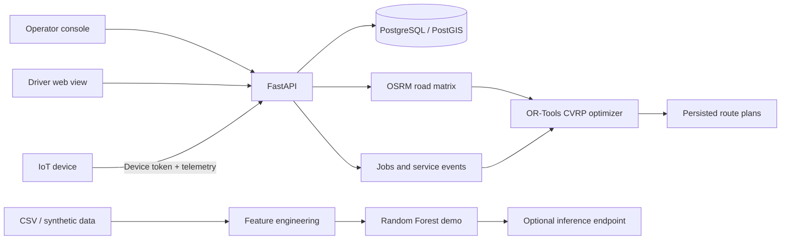

<div align="center">

# ♻️ Smart Waste Collection & Fleet Optimization

**Observe → forecast → prioritize → optimize → collect**

A full-stack waste-operations engineering prototype combining IoT telemetry, collection workflows, vehicle-capacity-aware route planning, and a map-based operations console.

[](https://github.com/kaustubhdua/smart_waste_project/actions)
[](https://github.com/kaustubhdua/smart_waste_project/actions/workflows/platform-api.yml)
[](https://github.com/kaustubhdua/smart_waste_project/actions/workflows/browser-e2e.yml)
[](https://github.com/kaustubhdua/smart_waste_project/actions/workflows/codeql.yml)


</div>

> **Honest status:** This is a portfolio/engineering prototype, not a proven municipal deployment. Demo records are synthetic, and no physical sensor calibration, production restore drill, live field pilot, or operational-savings claim has been validated. Review the [release checklist](docs/RELEASE_CHECKLIST.md) before treating it as production software.

## Contents

- [Highlights](#highlights)
- [Architecture](#architecture)
- [Run locally](#run-locally)
- [How the workflow fits together](#how-the-workflow-fits-together)
- [API overview](#api-overview)
- [Testing](#testing)
- [Security and deployment](#security-and-deployment)
- [Production deployment runbook](docs/DEPLOYMENT_RUNBOOK.md)
- [Security threat model](docs/SECURITY_THREAT_MODEL.md)
- [Known limitations](#known-limitations)
- [Repository map](#repository-map)

## Highlights

- **Telemetry ingestion:** per-device credentials, bin-scoped access, timestamp/freshness validation, duplicate-message idempotency, and stored reading history.
- **Collection lifecycle:** persistent jobs and service events, approval and assignment, start/complete/exception transitions, and completed-job verification.
- **Route optimization:** OSRM road-distance matrices and route geometry combined with OR-Tools capacity-constrained vehicle routing.
- **Transactional dispatch:** approved jobs are optimized against registered vehicles and assigned with route-plan history and service events.
- **Operator console:** responsive map-based bin monitoring, telemetry summary, vehicle/job controls, route preview/dispatch, and optional model forecasts.
- **Driver workflow:** vehicle-scoped assigned stops, collection status changes, exception reporting, and external navigation handoff.
- **ML demonstration:** feature engineering, Random Forest inference, chronological holdout evaluation and simple baselines. Forecast scope is deliberately limited to the next observed fill value.
- **Engineering quality:** SQLAlchemy persistence, Alembic migrations, Docker Compose, API readiness checks, Python CI, CodeQL, and browser-driven operator/driver smoke tests.

## Architecture



## Run locally

### Full-stack API + web console (recommended)

**Prerequisites:** Docker with the Compose plugin.

1. Clone the repository and enter its directory.
2. Create local environment settings from the template:

   ```bash
   cp .env.example .env
   ```

3. Replace the placeholder database and API secrets with unique local values. Keep `.env` out of Git.
4. Start the stack:

   ```bash
   docker compose up --build
   ```

5. Open the operator console at `http://localhost:8080`. The web container proxies `/api/*`, `/health`, `/health/ready`, `/docs` and `/openapi.json` to the API on the private Compose network, so the browser uses the same origin by default. Direct API docs remain available at `http://localhost:8000/docs` for local development.
6. Enter the configured `API_TOKEN` in the operator console. Local configuration can seed clearly labelled demo records; do not treat them as live sensor data.

For real telemetry, enroll a device through `POST /api/v1/devices`, securely store the one-time `X-Device-Token`, and send readings to `POST /api/v1/telemetry` using its enrolled `device_id`, bound `bin_id`, unique `message_id`, calibrated `fill_percent`, and timezone-aware timestamp. Device credentials can be rotated or revoked.

### Legacy Streamlit / ML demonstration

```bash
python -m venv .venv
# Activate the virtual environment
pip install -r requirements.txt
streamlit run app.py
```

Train the optional model artifact from the repository root with `python person2_ml_prediction.py`. The API loads an existing artifact for inference; it does not train the model during requests. The legacy Streamlit route solver uses approximate coordinate costs, while the backend optimizer uses road-network costs.

## How the workflow fits together

1. **Observe:** devices submit validated telemetry; duplicate messages are handled idempotently and stale readings are surfaced.
2. **Prioritize:** the platform scores collection candidates using a bounded, documented heuristic and recorded service history.
3. **Prepare:** operators review jobs and register vehicle capacity/depot details.
4. **Optimize:** approved jobs are routed using road-distance costs and vehicle capacity constraints.
5. **Dispatch:** the API persists the route plan and assigns stops transactionally.
6. **Collect:** drivers start, complete, or report an exception for their assigned stops.
7. **Verify:** operators review completed jobs and service history; completed work releases vehicles for subsequent dispatch.

## API overview

| Method | Endpoint | Purpose |
|---|---|---|
| `POST` | `/api/v1/bins` | Register a bin |
| `GET` | `/api/v1/bins` | List active bins |
| `POST` | `/api/v1/devices` | Enroll a device and issue its one-time token |
| `GET` | `/api/v1/devices` | List device status without revealing tokens |
| `POST` | `/api/v1/devices/{device_id}/rotate-token` | Rotate a device credential |
| `DELETE` | `/api/v1/devices/{device_id}` | Revoke a device credential |
| `POST` | `/api/v1/telemetry` | Ingest a device reading |
| `POST` | `/api/v1/telemetry/import-csv` | Import validated historical telemetry (2 MB / 10,000 row limit) |
| `GET` | `/api/v1/bins/{bin_id}/history` | Inspect stored readings |
| `GET` | `/api/v1/operations/summary` | Inspect freshness and job-state counts |
| `GET` | `/api/v1/forecasts` | Predict next-observation fill when history and model artifact are suitable |
| `POST` | `/api/v1/vehicles` | Register a collection vehicle |
| `POST` | `/api/v1/jobs` | Create a collection candidate |
| `GET` | `/api/v1/jobs` | List collection jobs, optionally filtered by status |
| `POST` | `/api/v1/jobs/{job_id}/assign` | Assign a job to a capacity-checked vehicle |
| `POST` | `/api/v1/jobs/{job_id}/transitions` | Record a validated lifecycle transition |
| `GET` | `/api/v1/jobs/{job_id}/events` | Inspect service history |
| `POST` | `/api/v1/routes/optimize` | Preview an optimized route plan |
| `POST` | `/api/v1/routes/dispatch` | Optimize approved jobs and assign stops transactionally |
| `GET` | `/api/v1/routes/plans` | List persisted route plans |
| `GET` | `/api/v1/routes/plans/{plan_id}` | Retrieve a route plan |
| `GET` | `/api/v1/driver/jobs` | List stops for an authenticated driver's vehicle |
| `POST` | `/api/v1/driver/jobs/{job_id}/transition` | Start, complete, or report a stop exception |
| `GET` | `/health/ready` | Check database readiness |

## Testing

Run the legacy Python tests:

```bash
pip install -r requirements.txt
python -m unittest discover -s tests -v
```

Run the backend/API tests:

```bash
cd backend
pip install -r requirements.txt
PYTHONPATH=. API_TOKEN=test-operator-token pytest -q
```

Browser tests run in GitHub Actions using Playwright Chromium. They mock API responses to verify key UI behaviors; they do not prove the production deployment works. The Platform API workflow also validates migrations, builds the Compose services, checks readiness, and smoke-tests the running stack.

## Security and deployment

- Production startup rejects SQLite, weak/placeholder API tokens, automatic schema creation, demo seeding, unsafe CORS settings, and the public demo OSRM router.
- Nginx adds browser security headers and a Content Security Policy. The current inline scripts/styles mean CSP still permits `unsafe-inline`; this is a known hardening opportunity.
- The operator API currently uses a shared bearer token. This is not multi-user identity or role-based authorization.
- Use a contracted or self-hosted routing service for deployment. The public OSRM demo service is for development only.
- Before public exposure, configure managed secrets, HTTPS/TLS, private database networking, rate limits, logs/alerts, automated encrypted backups and a tested restore procedure.
- Follow the [production operations runbook](docs/PRODUCTION_RUNBOOK.md) and [release acceptance checklist](docs/RELEASE_CHECKLIST.md). Do not mark unchecked acceptance gates complete without evidence.

## Known limitations

- The current operator authentication is a shared token; identity-based roles, per-user revocation and a complete audit trail remain to be implemented.
- No physical sensor, calibration process, municipal pilot, or real operational savings claim has been validated.
- The optional ML artifact predicts the next observed fill value rather than a calibrated 6/12-hour forecast. Keep model-assisted dispatch disabled until field evaluation supports it.
- Offline driver actions and turn-by-turn navigation are not implemented.
- Production hosting, restore drills, load/soak tests, monitoring ownership and field evaluation are environment-dependent and not claimed as complete.

## Repository map

| Path | What lives here |
|---|---|
| `backend/app/` | FastAPI routes, data models, configuration, routing and optimization |
| `backend/alembic/` | Database schema migrations |
| `web/` | Operator console, driver view and Nginx configuration |
| `tests/` | Core tests and Playwright browser E2E tests |
| `.github/workflows/` | CI, CodeQL and browser test workflows |
| `docs/` | Implementation status, release checklist and production runbook |
| `models/` | Optional local ML model artifact (generated; not required for core API use) |

Further detail: [implementation status](docs/IMPLEMENTATION_STATUS.md) and [platform notes](README_PLATFORM.md).
