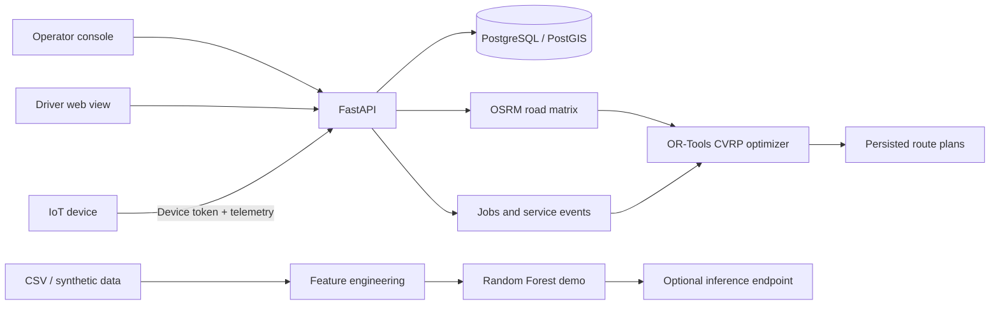

<div align="center">

# ♻️ Smart Waste Collection & Fleet Optimization

**Observe → forecast → prioritize → optimize → collect**

A full-stack waste-operations engineering prototype combining IoT telemetry, collection workflows, vehicle-capacity-aware route planning, and a map-based operations console.

[](https://github.com/kaustubhdua/smart_waste_project/actions)
[](https://github.com/kaustubhdua/smart_waste_project/actions/workflows/platform-api.yml)
[](https://github.com/kaustubhdua/smart_waste_project/actions/workflows/browser-e2e.yml)
[](https://github.com/kaustubhdua/smart_waste_project/actions/workflows/codeql.yml)


</div>

> **Honest status:** This is a portfolio/engineering prototype, not a proven municipal deployment. Demo records are synthetic and can only be seeded by explicitly setting `SEED_DEMO_DATA=true` outside production. No physical sensor calibration, production restore drill, live field pilot, or operational-savings claim has been validated. Review the [release checklist](docs/RELEASE_CHECKLIST.md) before treating it as production software.

## Contents

- [Highlights](#highlights)
- [Architecture](#architecture)
- [Run locally](#run-locally)
- [How the workflow fits together](#how-the-workflow-fits-together)
- [API overview](#api-overview)
- [Testing](#testing)
- [Security and deployment](#security-and-deployment)
- [Production deployment runbook](docs/DEPLOYMENT_RUNBOOK.md)
- [Security threat model](docs/SECURITY_THREAT_MODEL.md)
- [Known limitations](#known-limitations)
- [Repository map](#repository-map)

## Highlights

- **Telemetry ingestion:** per-device credentials, bin-scoped access, timestamp/freshness validation, duplicate-message idempotency, stored reading history, and explicit source provenance (`live`, `imported`, or `demo`).
- **Historical imports:** operators can upload validated CSV telemetry in the console; the API enforces row/size limits, rejects conflicting duplicates atomically, and labels accepted readings `imported` rather than `live`.
- **Collection lifecycle:** persistent jobs and service events, approval and assignment, start/complete/exception transitions, and completed-job verification.
- **Fuzzy prioritization:** a transparent three-input Sugeno inference engine combines fill level, time since verified emptying, and bin criticality.
- **Route optimization:** OSRM road-distance matrices and route geometry combined with OR-Tools capacity-constrained vehicle routing.
- **Transactional dispatch:** approved jobs are optimized against registered vehicles and assigned with route-plan history and service events.
- **Operator console:** responsive map-based bin monitoring, telemetry summary, vehicle/job controls, route preview/dispatch, optional model forecasts, and named-account sign-in with expiring sessions.
- **Operator identity:** one-time initial-admin bootstrap, named admin/operator accounts, password hashing, session expiry/revocation, account lockout, password changes and security audit events.
- **Driver workflow:** vehicle-scoped assigned stops, collection status changes, exception reporting, and external navigation handoff.
- **ML demonstration:** time-aware feature engineering, Random Forest inference, cadence-checked chronological holdout evaluation and simple baselines. Forecast scope is deliberately limited to the next observed fill value; cadence-mismatched history and legacy feature-schema artifacts are rejected.
- **Engineering quality:** SQLAlchemy persistence, Alembic migrations, Docker Compose, API readiness checks, Python CI, CodeQL, and browser-driven operator/driver smoke tests.

## Architecture



## Run locally

The default stack starts with an empty database: it does not generate synthetic bins, telemetry or vehicles. Records shown in the console come from the configured API/database. To intentionally load labeled demonstration data for a walkthrough, set `SEED_DEMO_DATA=true` in `.env` and restart the stack. Never use demo records as evidence of real sensor activity or operational performance.

### Full-stack API + web console (recommended)

**Prerequisites:** Docker with the Compose plugin.

1. Clone the repository and enter its directory.
2. Create local environment settings from the template:

   ```bash
   cp .env.example .env
   ```

3. Replace the placeholder database and API secrets with unique local values. Keep `.env` out of Git.
4. Start the stack:

   ```bash
   docker compose up --build
   ```

5. Open the operator console at `http://localhost:8080`, API documentation at `http://localhost:8000/docs`, and health endpoints at `http://localhost:8000/health` and `/health/ready`.
6. Create the first administrator once using `POST /api/v1/auth/bootstrap` with the `X-Bootstrap-Token` header set to your configured `API_TOKEN`, a unique username and a password of at least 12 characters. Then sign in to the operator console with that username/password. In production the bootstrap token is not accepted for normal API access. The default configuration starts empty. To intentionally seed synthetic demonstration records, set `SEED_DEMO_DATA=true` in `.env` and restart; never treat those records as live sensor data.

When creating a bin through `POST /api/v1/bins`, explicitly set `source` to `live`, `imported`, or `demo`; the API rejects missing provenance rather than guessing. For real telemetry, enroll a device through `POST /api/v1/devices`, securely store the one-time `X-Device-Token`, and send readings to `POST /api/v1/telemetry` using its enrolled `device_id`, bound `bin_id`, unique `message_id`, calibrated `fill_percent`, and timezone-aware timestamp. Device credentials can be rotated or revoked.

### Legacy Streamlit / ML demonstration

```bash
python -m venv .venv
# Activate the virtual environment
pip install -r requirements.txt
streamlit run app.py
```

Train the optional model artifact from the repository root with `python person2_ml_prediction.py`. The API loads an existing artifact for inference; it does not train the model during requests. The legacy Streamlit route solver uses approximate coordinate costs, while the backend optimizer uses road-network costs.

## How the workflow fits together

1. **Authenticate:** operators sign in with named accounts; sessions expire, can be revoked, and are checked against admin/operator privileges.
2. **Observe:** devices submit validated telemetry; duplicate messages are handled idempotently and stale readings are surfaced.
3. **Prioritize:** a three-input zero-order Sugeno fuzzy inference engine combines fill level, elapsed service time and bin criticality. Its defaults require local field calibration.
4. **Prepare:** operators review jobs and register vehicle capacity/depot details.
5. **Optimize:** approved jobs are routed using road-distance costs and vehicle capacity constraints.
6. **Dispatch:** the API persists the route plan and assigns stops transactionally.
7. **Collect:** drivers start, complete, or report an exception for their assigned stops.
8. **Verify:** operators review completed jobs and service history; completed work releases vehicles for subsequent dispatch.

## API overview

| Method | Endpoint | Purpose |
|---|---|---|
| `POST` | `/api/v1/auth/bootstrap` | Create the initial administrator once |
| `POST` | `/api/v1/auth/login` | Sign in and issue an eight-hour session |
| `GET` | `/api/v1/auth/me` | Inspect current operator identity |
| `POST` | `/api/v1/auth/logout` | Revoke current session |
| `POST` | `/api/v1/auth/change-password` | Change password, revoke all previous sessions and rotate the current session |
| `GET/POST` | `/api/v1/auth/users` | List/create named accounts (admin only) |
| `POST` | `/api/v1/auth/users/{username}/revoke` | Disable account and revoke sessions (admin only) |
| `GET` | `/api/v1/auth/audit` | Inspect security audit events (admin only) |
| `POST` | `/api/v1/bins` | Register a bin |
| `GET` | `/api/v1/bins` | List active bins |
| `GET` | `/api/v1/bins/nearby` | Find active bins within a radius using PostGIS geography and a GiST index |
| `POST` | `/api/v1/devices` | Enroll a device and issue its one-time token |
| `GET` | `/api/v1/devices` | List device status without revealing tokens |
| `POST` | `/api/v1/devices/{device_id}/rotate-token` | Rotate a device credential |
| `DELETE` | `/api/v1/devices/{device_id}` | Revoke a device credential |
| `POST` | `/api/v1/telemetry` | Ingest a device reading |
| `POST` | `/api/v1/telemetry/import-csv` | Import validated historical telemetry (2 MB / 10,000 row limit) |
| `GET` | `/api/v1/bins/{bin_id}/history` | Inspect stored readings |
| `GET` | `/api/v1/operations/summary` | Inspect freshness and job-state counts |
| `GET` | `/api/v1/forecasts` | Predict next-observation fill when history and model artifact are suitable |
| `POST` | `/api/v1/vehicles` | Register a collection vehicle |
| `POST` | `/api/v1/jobs` | Create a collection candidate |
| `GET` | `/api/v1/jobs` | List collection jobs, optionally filtered by status |
| `POST` | `/api/v1/jobs/{job_id}/assign` | Assign a job to a capacity-checked vehicle |
| `POST` | `/api/v1/jobs/{job_id}/transitions` | Record a validated lifecycle transition |
| `GET` | `/api/v1/jobs/{job_id}/events` | Inspect service history |
| `POST` | `/api/v1/routes/optimize` | Preview an optimized route plan |
| `POST` | `/api/v1/routes/dispatch` | Optimize approved jobs and assign stops transactionally |
| `GET` | `/api/v1/routes/plans` | List persisted route plans |
| `GET` | `/api/v1/routes/plans/{plan_id}` | Retrieve a route plan |
| `GET` | `/api/v1/driver/jobs` | List stops for an authenticated driver's vehicle |
| `POST` | `/api/v1/driver/jobs/{job_id}/transition` | Start, complete, or report a stop exception |
| `GET` | `/health/ready` | Check database readiness |

## Testing

Run the legacy Python tests:

```bash
pip install -r requirements.txt
python -m unittest discover -s tests -v
```

Run the backend/API tests:

```bash
cd backend
pip install -r requirements.txt
PYTHONPATH=. API_TOKEN=test-operator-token pytest -q
```

Browser tests run in GitHub Actions using Playwright Chromium. They mock API responses to verify key UI behaviors; they do not prove the production deployment works. The Platform API workflow also validates migrations, builds the Compose services, checks readiness, and smoke-tests the running stack.

## Security and deployment

The web container reverse-proxies `/api/*` and health/API documentation routes to the API over the private Compose network. Both browser views default to same-origin API access, so a hosted HTTPS deployment does not accidentally call `localhost` on each visitor's device. Keep the browser console and API same-origin for first-party cookie authentication. Non-browser integrations should use a cookie jar from the login flow or a separately managed service identity; this project does not issue long-lived operator API tokens. Never store browser sessions in JavaScript storage.

- Production startup rejects SQLite, weak/placeholder bootstrap secrets, automatic schema creation, demo seeding, unsafe CORS settings, and the public demo OSRM router.
- Named operator/admin accounts use salted PBKDF2 password hashes, eight-hour HttpOnly/SameSite=Strict browser cookies (Secure in production), opaque session hashes, account lockout, account/session revocation, password-change session rotation, and audit events. Cookie-authenticated state changes validate the request Origin; browser credentials are never exposed to JavaScript storage. The shared API_TOKEN is a one-time bootstrap secret in production and remains a local-development compatibility credential only.
- Nginx adds browser security headers and a Content Security Policy. Operator and driver JavaScript is served from same-origin files, so `script-src` does not allow `unsafe-inline`. Inline styles still require `unsafe-inline` and remain a hardening opportunity.
- Application-level admin/operator roles are implemented, but external SSO/OAuth, MFA, distributed ingress rate limiting beyond the included Nginx per-IP login/bootstrap limit, and a formal penetration test remain outstanding.
- Use a contracted or self-hosted routing service for deployment. The public OSRM demo service is for development only.
- Before public exposure, configure managed secrets, HTTPS/TLS, private database networking, rate limits, logs/alerts, automated encrypted backups and a tested restore procedure.
- Follow the [production operations runbook](docs/PRODUCTION_RUNBOOK.md) and [release acceptance checklist](docs/RELEASE_CHECKLIST.md). Do not mark unchecked acceptance gates complete without evidence.

## Known limitations

- The operator identity foundation is implemented; external identity federation/MFA, distributed ingress rate limiting and formal security testing remain outstanding.
- No physical sensor, calibration process, municipal pilot, or real operational savings claim has been validated.
- The optional ML artifact predicts the next observed fill value rather than a calibrated 6/12-hour forecast. Keep model-assisted dispatch disabled until field evaluation supports it.
- Offline driver actions and turn-by-turn navigation are not implemented.
- Production hosting, restore drills, load/soak tests, monitoring ownership and field evaluation are environment-dependent and not claimed as complete.

## Repository map

| Path | What lives here |
|---|---|
| `backend/app/` | FastAPI routes, data models, configuration, routing and optimization |
| `backend/migrations/` | Alembic database schema migrations |
| `web/` | Operator console, driver view and Nginx configuration |
| `tests/` | Core tests and Playwright browser E2E tests |
| `.github/workflows/` | CI, CodeQL and browser test workflows |
| `docs/` | Implementation status, release checklist and production runbook |
| `models/` | Optional local ML model artifact (generated; not required for core API use) |

Further detail: [implementation status](docs/IMPLEMENTATION_STATUS.md) and [platform notes](README_PLATFORM.md).
